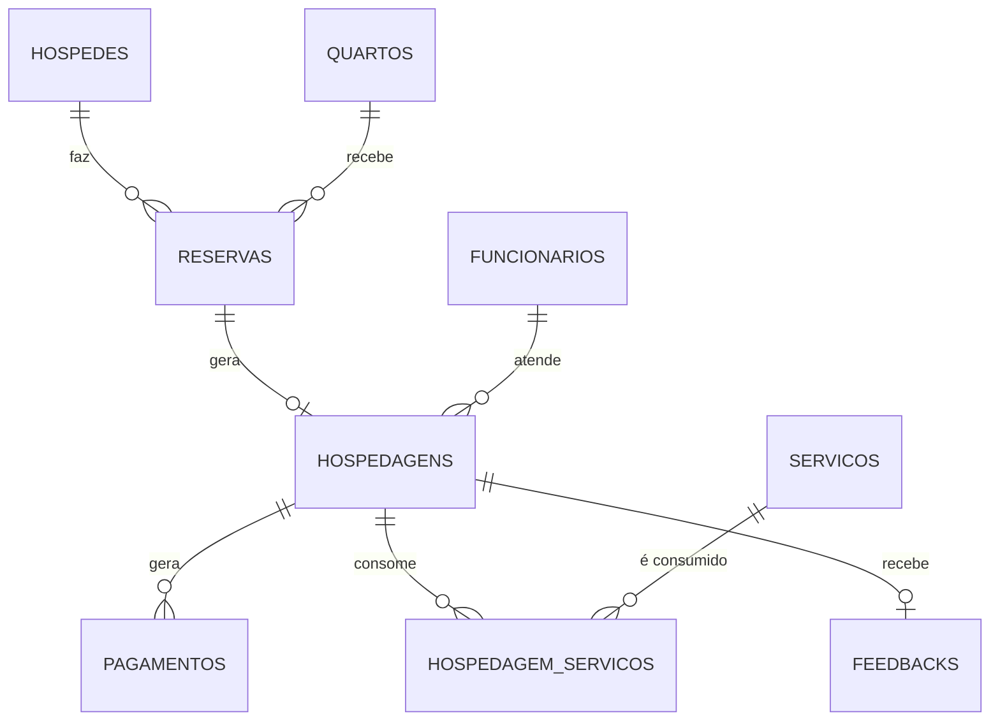

# Hotel Nebula - Projeto de Banco de Dados

Projeto de banco de dados para organizar as informações do Hotel Nebula: hóspedes, quartos, reservas, hospedagens, pagamentos, funcionários, serviços e avaliações.

## Arquivos

- `README.md`: documentação (Partes 1 e 2)
- `01_criacao_banco.sql`: criação do banco e das tabelas
- `02_insercao_dados.sql`: dados de teste
- `03_consultas.sql`: consultas SQL (Parte 3)

Para executar (MySQL 8.0.16 ou superior), rode os scripts nessa ordem: 01, 02 e 03.

---

## Parte 1 - Modelagem

### Diagrama ER

### Entidades

| Entidade | O que representa |
|---|---|
| hospedes | Clientes do hotel |
| quartos | Quartos, com tipo, capacidade, preço da diária e status |
| reservas | Reserva de um quarto por um hóspede, com período e status |
| hospedagens | Estadia real, criada quando o hóspede faz o check-in |
| pagamentos | Pagamentos de uma hospedagem |
| funcionarios | Profissionais do hotel |
| servicos | Serviços extras oferecidos (café, lavanderia, spa...) |
| hospedagem_servicos | Serviços consumidos em cada hospedagem |
| feedbacks | Avaliação (nota de 1 a 5 e comentário) de uma hospedagem |

### Relacionamentos

| Relacionamento | Tipo | Como ficou no banco |
|---|---|---|
| Hóspede faz reservas | 1:N | `reservas.id_hospede` |
| Quarto recebe reservas | 1:N | `reservas.id_quarto` |
| Reserva gera hospedagem | 1:1 | `hospedagens.id_reserva` (UNIQUE) |
| Funcionário atende hospedagens | 1:N | `hospedagens.id_funcionario` |
| Hospedagem gera pagamentos | 1:N | `pagamentos.id_hospedagem` |
| Hospedagem consome serviços | N:N | tabela `hospedagem_servicos` |
| Hospedagem recebe feedback | 1:1 | `feedbacks.id_hospedagem` (UNIQUE) |

O feedback fica ligado à hospedagem porque, a partir dela, dá para descobrir o hóspede e o quarto (hospedagem → reserva → hóspede e quarto). Assim não repetimos dados, e só quem se hospedou consegue avaliar.

### Regras de negócio

1. Toda reserva é de um hóspede para um quarto, e o check-out deve ser depois do check-in.
2. Um quarto não pode ter duas reservas (não canceladas) no mesmo período.
3. Quartos em manutenção não ficam disponíveis para reserva.
4. Uma reserva gera no máximo uma hospedagem (no check-in).
5. Uma hospedagem pode ter vários pagamentos e vários serviços.
6. Cada hospedagem é atendida por um funcionário e recebe no máximo uma avaliação, com nota de 1 a 5.
7. Se `checkout_real` está vazio, o hóspede ainda está no hotel.

---

## Parte 2 - Implementação

O que foi completado no modelo lógico:

- **Tabelas novas:** `servicos`, `hospedagem_servicos` (associação) e `feedbacks`.
- **Colunas novas:** `cidade` em hospedes; `data_pagamento` em pagamentos; `id_funcionario` em hospedagens; `telefone` em funcionarios.
- **Restrições usadas:** `PRIMARY KEY`, `FOREIGN KEY`, `UNIQUE`, `NOT NULL`, `DEFAULT` e dois `CHECK` (`data_checkout > data_checkin` e nota entre 1 e 5).
- **Tipos:** `DECIMAL(10,2)` para dinheiro, `DATE` para datas e `DATETIME` para check-in e check-out reais.

Os dados de teste têm 5 hóspedes, 5 quartos, 3 funcionários, 5 serviços, 9 reservas (2 canceladas), 6 hospedagens, 8 consumos de serviço, 6 pagamentos e 5 feedbacks.

---

## Parte 3 - Consultas

| # | Pergunta |
|---|---|
| 1 | Quartos disponíveis em um período |
| 2 | Hóspedes que mais reservaram |
| 3 | Faturamento por mês |
| 4 | Serviços extras mais consumidos |
| 5 | Quartos com melhores avaliações |
| 6 | Reservas canceladas |
| 7 | Hospedagens atendidas por profissional |
